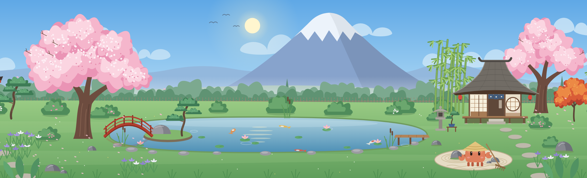

# Zen Clawd Garden

A theme for the Claude desktop app. A little Clawd tends a quiet garden behind your conversations: a koi pond, a tea room, bamboo, cherry trees in bloom. The sky follows your local time and weather, and the app's colors follow the sky.



Inspired by Gmail's old "Zen Fox Tea House" theme. This is an unofficial fan project and is not made or endorsed by Anthropic.

## What it does

- **A day in the garden.** Clawd has 23 things it does, picked by the hour and the weather: stretching at dawn, watering, feeding the koi, raking gravel, painting, tea, lighting lanterns, stargazing, sleeping in the tea room.
- **Weather.** Rain brings an umbrella or puddles to splash in, wind brings a kite and blowing leaves, snow brings a snow crab. Fog, storms and overcast skies each look different.
- **Sky and colors.** Sunrise, golden hour, dusk and night are timed to your real sunrise and sunset, with the right moon phase. The app's own colors shift with them.
- **Slow motion.** Clouds drift, stars twinkle, fireflies wander, koi circle the pond, rain ripples the water, petals fall, plants stir in the breeze and Clawd blinks.
- **Any window size.** The horizon stays 300 px up and the sky stretches above it. The middle of the scene is kept clear for the conversation, and the scenery runs out to ultrawide and 4K widths.

## Install

In the Claude desktop app: click **+** next to the prompt box, then **Plugins**, **Add marketplace** with `dben/zen-clawd-garden`, then **Add plugin**. Restart the app if the garden does not appear.

At the prompt of a terminal session:

```
/plugin install zen-clawd-garden --marketplace dben/zen-clawd-garden
```

From a shell:

```
claude plugin install zen-clawd-garden --marketplace dben/zen-clawd-garden
```

The garden is drawn by the desktop and mobile apps. Nothing is drawn in a terminal.

## The `/garden` command

| Command | What it does |
| --- | --- |
| `/garden` | Says what the garden is showing and why |
| `/garden list` | Lists everything Clawd does |
| `/garden preview rain dusk` | Previews an activity, a weather or a time (`fish`, `snow`, `windy`, `21:00`, `sunrise`) |
| `/garden live` | Goes back to the real sky |
| `/garden motion on\|off` | Turns the animation on or off |
| `/garden veil clear\|soft\|frosted` | How strongly the app's panels frost over the garden |
| `/garden center <px>` | Nudges the scene left or right to line up with the conversation |
| `/garden layout fixed\|scaled` | Fixed horizon, or the whole picture stretched to cover the window |
| `/garden location <lat> <lon>` | Sets where the weather is read for; `auto` goes back to guessing |

## What it contacts

To know your weather, the garden needs a rough location. Unless you set one yourself, it:

1. asks [ipwho.is](https://ipwho.is/) (or [geojs.io](https://www.geojs.io/) if that fails) for an approximate location from your network address, at most once a week, and rounds it to a tenth of a degree (about 10 km);
2. asks [Open-Meteo](https://open-meteo.com/) for the current weather, sunrise and sunset at that rounded position, every 20 minutes.

It sends nothing else, and nothing about your conversations. To skip the location lookup entirely, set your own: `/garden location 35.0 135.8`.

## Developing

The scene is one SVG string built in `hooks/scene.ts`; Clawd and its activities are in `hooks/crab.ts`, the sky and schedule in `hooks/sky.ts`, the app palette in `hooks/palette.ts`, and the hooks and command in `hooks/register.tsx`.

```
claude plugin validate .
claude plugin test .
```

A backdrop may be at most 131,072 characters; the busiest scene is about 114,000, so check the size test before adding scenery.

## License

MIT. See [LICENSE](LICENSE).

`hooks/make-colors.js` and `hooks/make-colors.d.ts` are the unmodified color helper that ships with Claude Code's mod-authoring kit, included as that kit instructs; they are not covered by this license.
